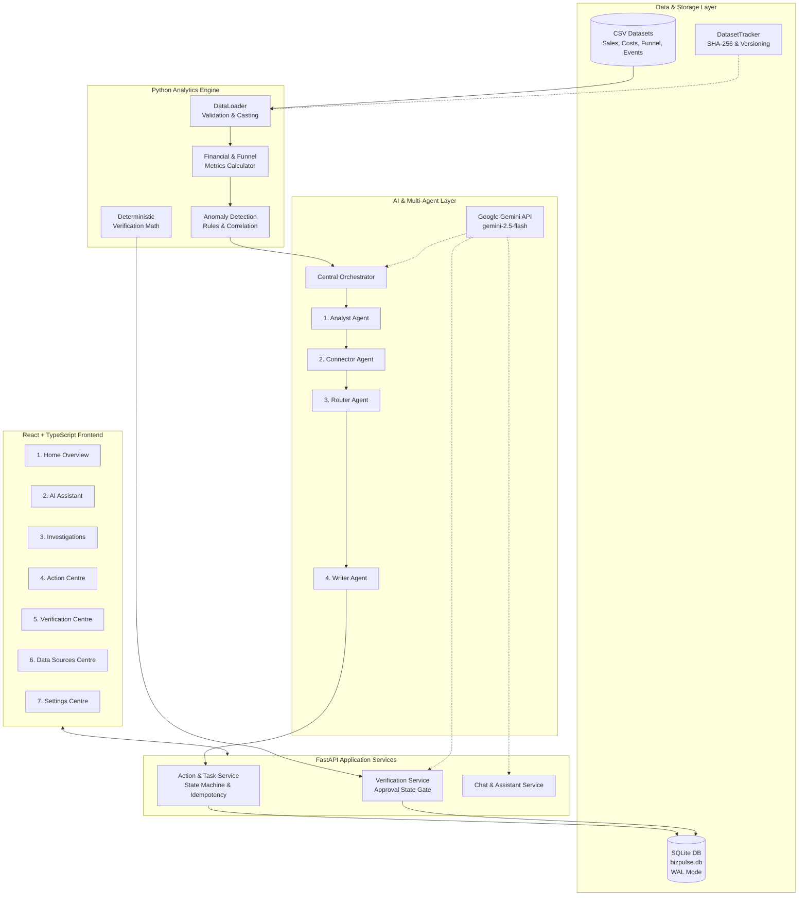
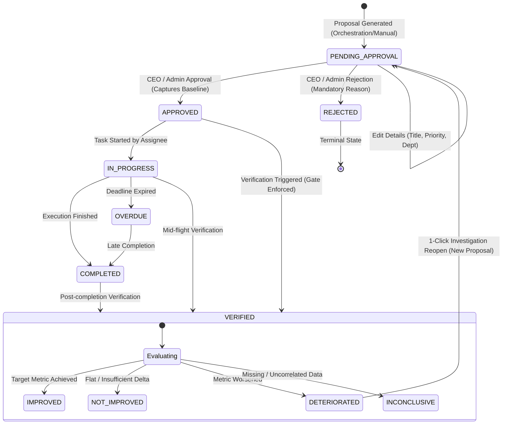

# BizPulse — System Architecture & Design Specification

> **Version**: 0.5.0  
> **Status**: Verified & Integrated  
> **Target Audience**: Software Engineers, System Architects, Technical Evaluators

---

## 1. System Overview

BizPulse is an autonomous decision intelligence platform bridging the gap between statistical anomaly detection and verifiable business remediation. It continuously analyzes operational data, coordinates multi-role AI agents to diagnose root causes, facilitates human-in-the-loop managerial approvals, tracks task execution, and verifies whether remediation successfully resolved the original problem.



---

## 2. Core Architectural Components

### 2.1 React + TypeScript Frontend
- **Framework**: React 18 with TypeScript 5, bundled via Vite.
- **Styling & Icons**: Custom dark/light responsive CSS design token system (`index.css`), Lucide React icons.
- **State Management**:
  - `AppContext`: Global navigation state, active anomaly tracking, and system health status.
  - `SettingsContext`: User identity, executive role simulation (CEO, Ops Manager, Marketing Lead, Finance Analyst), theme preference, and AI model selection.
- **API Client Layer**: Dedicated client modules in `frontend/src/api/` (`actions.ts`, `verification.ts`, `datasets.ts`, `investigations.ts`, `overview.ts`, `chat.ts`) wrapping native `fetch` with error normalization.

### 2.2 FastAPI Backend Application
- **Runtime**: Python 3.13 asynchronous ASGI server powered by Uvicorn.
- **Router Structure**:
  - `/api/overview`, `/api/sales`, `/api/funnel`, `/api/products/profitability`: Core financial and funnel metric routes.
  - `/api/anomalies`, `/api/events`: Anomaly feed and operational event log.
  - `/api/chat`: Grounded conversational business assistant.
  - `/api/investigate`: Single-anomaly diagnostic deep dive.
  - `/api/agents/run`: Four-agent orchestration pipeline.
  - `/api/actions/*`: Proposal creation, idempotent batch generation, approval, rejection, and editing.
  - `/api/tasks/*`: Task execution, status progression, assignment, deadline, and progress notes.
  - `/api/verification/*`: Baseline metric capture, deterministic evaluation, follow-up recommendations, and investigation reopening.
  - `/api/datasets/*`: Dataset inventory, schema inspection, live statistics, and transactional upload.
- **Error Handling**: Custom exception hierarchy in `app.core.errors` mapped to standardized HTTP status codes (400, 401, 404, 409, 500, 502) with automatic API key redaction.

### 2.3 Python Analytics Engine
- **Data Loaders**: Load and validate four foundational datasets (`sales.csv`, `costs.csv`, `website_funnel.csv`, `events.csv`) from `backend/data/`.
- **Anomaly Detection Engine**:
  - **Revenue Decline**: Identifies week-over-week revenue drops exceeding 15% (e.g. -18.00% anomaly).
  - **Margin Squeeze**: Identifies products with unit margins below standard thresholds (e.g. Premium Plan at 35% margin).
  - **Funnel Deterioration**: Detects payment gateway failures and device conversion drops (e.g. Mobile checkout dropping from 38% to 12% following deployment `DEP-002`).
- **Deterministic Verification Engine**:
  - Computes exact mathematical delta and percentage change between baseline and verification snapshots.
  - Applies strict outcome logic: `IMPROVED`, `NOT_IMPROVED`, `DETERIORATED`, `INCONCLUSIVE`.

### 2.4 Google Gemini AI Integration & Multi-Agent Orchestrator
- **Model**: `gemini-2.5-flash` via the official Google GenAI SDK.
- **Security**: Strict key redaction (`_sanitize_error()`) ensuring `AIza...` tokens never appear in logs or error responses.
- **Specialized 4-Agent Pipeline**:
  ```
  [Raw Anomaly + Fact Dict]
            │
            ▼
  1. ANALYST AGENT  ➔ Validates metrics, extracts exact numbers, isolates statistical scope.
            │
            ▼
  2. CONNECTOR AGENT ➔ Correlates operational events (e.g., DEP-002 Stripe SDK update) with metric shifts.
            │
            ▼
  3. ROUTER AGENT    ➔ Identifies responsible department (Product, Engineering, Marketing, Finance).
            │
            ▼
  4. WRITER AGENT    ➔ Synthesizes findings into executive proposals with concrete action items.
  ```

### 2.5 SQLite Persistence Layer (`bizpulse.db`)
- **Database Engine**: SQLite 3 with Write-Ahead Logging (`PRAGMA journal_mode=WAL`) and foreign key enforcement (`PRAGMA foreign_keys=ON`).
- **Core Tables**:
  - `actions`: Action proposals and tasks, lifecycle status, assigned department/owner, deadline, fingerprint, and verification metadata.
  - `action_audit_log`: Chronological history of status updates, reassignments, edits, and note additions.
  - `verification_records`: Snapshot of baseline metrics, post-remediation metrics, delta math, outcome enum, and Gemini narrative explanation.
  - `verification_notes`: Threaded diagnostic annotations attached to verification cycles.

### 2.6 Dataset Version Tracking & Invalidation Engine (`DatasetTracker`)
- Thread-safe singleton (`backend/app/analytics/dataset_tracker.py`) managing dataset metadata.
- Computes SHA-256 cryptographic digests of on-disk CSV files.
- Increments integer version counters upon file mutation.
- Dispatches change notifications to registered listeners (`DataLoader.clear_cache()`, `AnalyticsEngine.clear_cache()`).
- Safeguards uploads with automatic `.bak` snapshotting and transactional restoration upon schema invalidity.

---

## 3. Business Remediation Lifecycle State Machine

BizPulse enforces a strict state machine across the complete problem-to-resolution lifecycle:



### State Machine Rules
1. **Pre-Approval Editing**: An action proposal may be edited **only** while in `PENDING_APPROVAL`. Once approved or rejected, editing is strictly rejected (HTTP 400).
2. **Mandatory Rejection Justification**: Rejection requires a non-empty `reason` string, permanently recorded in the audit trail.
3. **Immutable Baseline Capture**: Baseline metrics are captured at the exact moment of approval and cannot be modified.
4. **Verification Approval State Gate**: Verification can **only** be executed if the action is in `APPROVED`, `IN_PROGRESS`, or `COMPLETED`. Calls against `PENDING_APPROVAL` or `REJECTED` return **HTTP 409 Conflict**.
5. **Terminal Protection**: `COMPLETED` actions cannot transition backward to `IN_PROGRESS` or `PENDING_APPROVAL`.

---

## 4. Idempotency & Concurrency Design

To prevent duplicate proposals and race conditions when multiple users or asynchronous agents trigger investigations:

1. **Deterministic Fingerprinting**:
   $$\text{Fingerprint} = \text{SHA256}(\text{anomaly\_id} + \text{normalized}(\text{action\_title}) + \text{normalized}(\text{action\_description}))$$
2. **In-Memory Re-entrancy Lock**: A process-level `threading.Lock` coordinates proposal generation during concurrent agent runs.
3. **Database Unique Partial Index**:
   ```sql
   CREATE UNIQUE INDEX IF NOT EXISTS idx_actions_fingerprint 
   ON actions (action_fingerprint) 
   WHERE action_fingerprint IS NOT NULL AND status != 'REJECTED';
   ```
4. **Graceful Duplicate Handling**: When an identical action is generated, BizPulse queries and returns the existing record rather than failing or creating duplicates.

---

## 5. Security & Isolation Architecture

1. **API Key Redaction**: Custom logging filter and exception handler sanitizes all outbound error messages matching the Gemini regex `AIza[0-9A-Za-z-_]{35}`.
2. **Sandbox & Storage Isolation**: Uploaded CSV files are strictly confined to `backend/data/` with validated MIME types and mandatory header checks.
3. **Frontend Decoupling**: The Vite production bundle contains zero private keys or server tokens. All communication travels across the origin-whitelisted REST API.
